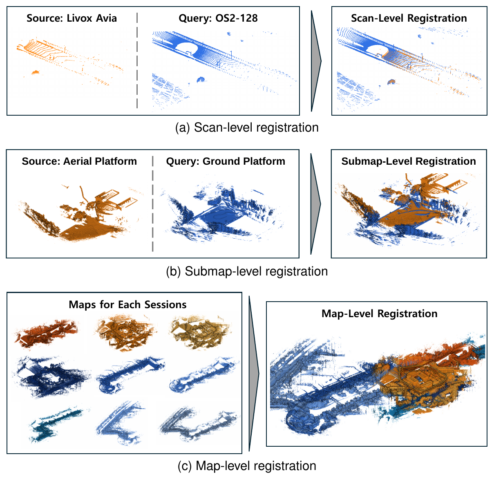

# XAnchor-Reg

**XAnchor-Reg: Composable Anchors with Cross-Domain Descriptors for Multi-Level Point Cloud Registration**

<p align="center"></p>

XAnchor-Reg registers LiDAR point clouds at the scan, submap, and map levels with a single representation.
A pretrained 3D backbone ([Utonia](https://github.com/Pointcept/Utonia)), adapted with LiDAR point clouds and poses only,
produces point-level descriptors that stay consistent across LiDAR types, platforms, and sessions. The descriptors are
aggregated into fixed-size cells (anchors), which are the basic unit of registration. Anchors are computed once per point
cloud, and the anchors of several submaps are merged into the representation of a larger map without re-encoding.

```
point cloud ──► descriptor encoder ──► cell anchors ──► (merge) ──► MNN correspondences ──► SC²-PCR ──► (GICP)
```

## To-do

- [ ] Release the trained model weights
- [ ] Release the paper and citation

## Installation

Tested with Python 3.10, PyTorch 2.7.1 (CUDA 12.8), spconv 2.3.8, flash-attn 2.8.3, and an NVIDIA RTX 5090.

1. Install PyTorch for your CUDA version.
2. Install Utonia in package mode, following the [Utonia installation guide](https://github.com/Pointcept/Utonia#installation)
   (spconv, torch-scatter, huggingface_hub, timm; flash-attn is optional but roughly halves the encoder time and memory).
3. Install this package:

```bash
git clone https://github.com/NSCL/XAnchor-Reg.git
cd XAnchor-Reg
pip install -e ".[refine,demo]"
```

`refine` installs [small_gicp](https://github.com/koide3/small_gicp) for the optional GICP refinement (Open3D GICP is used
when it is not installed), and `demo` installs Open3D for reading `.ply`/`.pcd` files and visualization.

The encoder downloads the pretrained Utonia model from Hugging Face on first use and then loads the XAnchor-Reg weights.

## Quick start

```bash
python scripts/demo_register.py --weights xanchor_reg.pt \
    --source source.ply --target target.ply --level submap --refine --show
```

`--source` and `--target` accept `.npy` (N×3 or more), KITTI `.bin`, `.ply`, and `.pcd`. Several files per side are merged
into one map; they must be in a common frame. The estimated 4×4 transform maps the source into the target frame.

## Python API

```python
from xanchor import LEVELS, DescriptorEncoder, compute_anchors, merge_anchors, register

encoder = DescriptorEncoder('xanchor_reg.pt')
cfg = LEVELS['submap']

source = compute_anchors(xyz_source, encoder(xyz_source), cfg['cell_size'])
target = compute_anchors(xyz_target, encoder(xyz_target), cfg['cell_size'])

result = register(source, target, min_support=cfg['min_support'])
T = result.transform
```

Anchors are composable. Compute them once per submap and merge them to register larger maps:

```python
submap_anchors = [compute_anchors(x, encoder(x), 3.0) for x in submaps]
map_anchors = merge_anchors(submap_anchors)
result = register(map_anchors, other_map_anchors, min_support=3)
```

Pass `points_source` and `points_target` to `register` to refine the coarse estimate with GICP.

## Settings

| Level | Cell size | Minimum support | GICP max. correspondence distance |
|---|---|---|---|
| `scan` | 1 m | 1 | 0.5 m |
| `submap` | 3 m | 3 | 1.0 m |
| `map` | 3 m | 3 | 1.0 m |

At most 8,000 mutual nearest-neighbor correspondences are passed to SC²-PCR, whose compatibility and inlier thresholds
are 1.0 m.

## Input frames

- Scans can be given in their own sensor frames.
- Submaps and maps should be in a frame whose z-axis is approximately aligned with gravity. An arbitrary yaw rotation and
  translation between the two inputs is allowed, and no initial alignment is needed.
- Submaps merged into one map must be expressed in a common frame before their anchors are computed.

## Acknowledgements

- [Utonia](https://github.com/Pointcept/Utonia) (Apache-2.0) provides the pretrained backbone.
- `xanchor/sc2pcr.py` is adapted from [SC²-PCR](https://github.com/ZhiChen902/SC2-PCR) (MIT).

## License

This project is released under the [MIT License](LICENSE).
